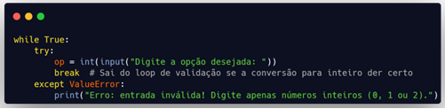
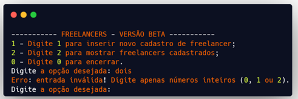
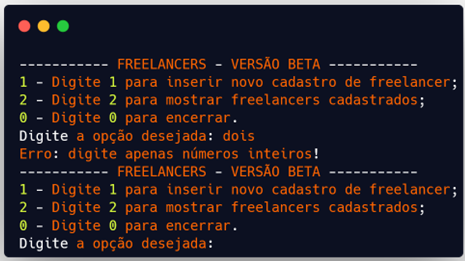

# Aplicação de Cadastro de Freelancers (Versão Beta)

Projeto desenvolvido para a atividade **MAPA** da disciplina **Linguagem de Programação** do curso de **Ciência de Dados e Análise do Comportamento (UniCesumar)**.

## Navegação Rápida
* [1. Contextualização e Objetivo](#1-contextualização-e-objetivo)
* [2. Código-Fonte Completo e Documentado](#2-código-fonte-completo-e-documentado)
* [3. Teste de Mesa (Massa de Dados de Validação)](#3-teste-de-mesa-massa-de-dados-de-validação)
* [4. Resolução das Questões e Evidências de Execução](#4-resolução-das-questões-e-evidências-de-execução)
  * [Questão A — Acesso a chave inexistente (Figura 1)](#questão-a)
  * [Questão B — Remoção da condição de limite (Figuras 2 e 3)](#questão-b)
  * [Questão C — Entrada não numérica e robustez (Figuras 4, 5, 6, 7 e 8)](#questão-c)
  * [Questão D — Função da linha cont += 1 (Figura 9)](#questão-d)
* [5. Referências](#5-referências)

---

## 1. Contextualização e Objetivo

O projeto consiste em uma aplicação de linha de comando (CLI) desenvolvida em Python para o cadastro e a listagem de até **5 freelancers**. Cada registro armazena um código identificador único (`cod`), nome, e-mail, linguagem de programação principal e valor por hora trabalhada.

---

## 2. Código-Fonte Completo e Documentado

O código completo e comentado pode ser acessado diretamente no arquivo [`mapa.py`](./mapa.py) ou visualizado abaixo:

~~~python
# ==============================================================================
# ATIVIDADE: MAPA - LINGUAGEM DE PROGRAMAÇÃO - 54_2026
# PROJETO: Aplicação de Cadastro de Freelancers (Versão Beta)
# OBJETIVO: Permitir o cadastro (até 5 registros) e a listagem de profissionais
#           utilizando listas, dicionários, funções e estruturas de repetição.
# CURSO: Ciência de Dados e Análise do Comportamento
# UNIVERSIDADE: UniCesumar
# ALUNO: Ricardo Freitas
# ==============================================================================

# 1. ESTRUTURA DE ARMAZENAMENTO GLOBAL
# Cria uma lista vazia que funcionará como o "banco de dados" em memória.
# Cada posição desta lista armazenará um dicionário representando um freelancer.
lista = []

# 2. DEFINIÇÃO DAS FUNÇÕES AUXILIARES

# A função imprime percorre todos os dicionários armazenados na 'lista' e exibe
# os dados formatados de cada freelancer cadastrado.
# O laço 'for' acessa um dicionário por vez dentro da lista.
def imprime():
    for freelancer in lista:
        print("*** Código do freelancer:", freelancer["cod"])
        print("Nome:", freelancer["nome"])
        print("E-mail:", freelancer["email"])
        print("Linguagem:", freelancer["linguagem"])
        print("Preço por hora (R$):", freelancer["valor"])
        print("-----------")

# A função menu exibe o cabeçalho e as opções de navegação disponíveis para o
# usuário. Não recebe parâmetros e não retorna valores; apenas imprime na tela.
def menu():
    print("----------- FREELANCERS - VERSÃO BETA -----------")
    print("1 - Digite 1 para inserir novo cadastro de freelancer;")
    print("2 - Digite 2 para mostrar freelancers cadastrados;")
    print("0 - Digite 0 para encerrar.")

# 3. VARIÁVEIS DE CONTROLE DO FLUXO

# 'cont' gera um identificador único (ID) sequencial iniciando em 0 (0, 1, 2, 3, 4).
cont = 0

# 'op' armazena a escolha do usuário no menu. Inicia com -1 (valor diferente de 0)
# para garantir que o programa entre no laço 'while' pela primeira vez.
op = -1

# 4. LOOP PRINCIPAL DA APLICAÇÃO
# Mantém o programa em execução contínua até que o usuário digite 0 para sair.
while op != 0:
    menu()             # Chama a função que desenha o menu na tela
    op = int(input())  # Lê a opção digitada e converte de texto (str) para inteiro

    # --- OPÇÃO 1: CADASTRAR NOVO FREELANCER ---
    if op == 1:
        if len(lista) < 5:   # Verifica se a lista ainda tem menos de 5 cadastros
            freelancer = {}  # Cria um dicionário vazio p/ agrupar os dados do novo cadastro

            # Preenche as chaves do dicionário com o ID automático e as entradas do usuário
            freelancer["cod"] = cont
            freelancer["nome"] = input("Insira o nome do freelancer:\n")
            freelancer["email"] = input("Insira o e-mail do freelancer:\n")
            freelancer["linguagem"] = input("Insira principal linguagem de programação do freelancer:\n")
            # Converte o texto p/ número decimal (float), exigindo ponto (ex: 120.00)
            freelancer["valor"] = float(input("Insira preço do freelancer por hora trabalhada:\n"))

            # Adiciona o dicionário preenchido ao final da lista principal
            lista.append(freelancer)
            # Incrementa o contador para que o próximo freelancer receba o próximo código
            cont += 1

        # Caso len(lista) já seja igual a 5, impede novos cadastros
        else:
            print("Lista de freelancers lotada!")
        # Pausa a execução para o usuário ler o resultado antes de reexibir o menu
        input("Pressione Enter para continuar...")

    # --- OPÇÃO 2: LISTAR FREELANCERS CADASTRADOS ---
    elif op == 2:
        # 'if not lista:' verifica se a lista está vazia (equivale a len(lista) == 0)
        if not lista:
            print("Lista de freelancers vazia!")
        else:
            # Se houver pelo menos 1 cadastro, chama a função de exibição
            imprime()
        input("Pressione Enter para continuar...")

    # --- VALIDAÇÃO DE OPÇÃO INVÁLIDA ---
    # Se 'op' não for 1, nem 2 e nem 0, informa que o comando não existe
    elif op != 0:
        print("Erro: opção inválida!")
        input("Pressione Enter para continuar...")
~~~

---

## 3. Teste de Mesa (Massa de Dados de Validação)

Para validar o comportamento do sistema e simular os cenários das questões abaixo, foram utilizados os seguintes registros de teste:

| Código (`cod`) | Nome | E-mail | Linguagem Principal | Preço por Hora (R$) |
| :---: | :--- | :--- | :--- | :---: |
| `0` | Ana Clara Silva | `ana.silva@exemplo.com.br` | Python | `120.00` |
| `1` | Bruno Henrique Costa | `bruno.costa@exemplo.com.br` | JavaScript | `110.00` |
| `2` | Carla Mendes Oliveira | `carla.oliveira@exemplo.com.br` | Java | `135.00` |
| `3` | Diego Ferreira Santos | `diego.santos@exemplo.com.br` | C# | `115.00` |
| `4` | Eduarda Lima Rocha | `eduarda.rocha@exemplo.com.br` | SQL | `95.00` |

---

## 4. Resolução das Questões e Evidências de Execução

### Questão A
> **Enunciado:** O código acima apresenta uma função chamada `imprime()`. Explique qual seria o comportamento do programa se, ao invés de `print("Preço por hora (R$):", freelancer["valor"])`, fosse utilizado `print("Preço por hora (R$):", freelancer["preco"])`.

**Resposta:**
Ao alterar a chave de `freelancer["valor"]` para `freelancer["preco"]`, o programa continuará realizando normalmente o cadastro dos freelancers pela opção 1, pois o preço por hora permanece sendo armazenado no dicionário por meio da chave `"valor"`. Entretanto, ocorrerá um erro quando o usuário selecionar a opção 2 para exibir os cadastros.

Quando a função `imprime()` for chamada, ela percorrerá a lista e exibirá os dados do freelancer, como código, nome, e-mail e linguagem de programação. Contudo, ao tentar acessar `freelancer["preco"]`, o Python não encontrará essa chave no dicionário, uma vez que o valor foi armazenado anteriormente com a chave `"valor"`, e que o termo do dicionário funciona como chave de acesso ao dado (OLIVEIRA, 2023, p. 110).

Caso exista pelo menos um freelancer cadastrado, essa tentativa de acessar uma chave inexistente provocará uma exceção do tipo `KeyError: 'preco'`, interrompendo a execução do programa de forma abrupta, pois o código original não apresenta tratamento para essa exceção ([Figura 1](./imagens/figura1_keyerror.png)).

É importante observar que, se a lista estiver vazia, o erro não ocorrerá, pois o laço `for` da função `imprime()` não será executado e, consequentemente, a chave inexistente não será acessada. Portanto, para corrigir o problema, é necessário manter a correspondência entre o nome da chave utilizada no armazenamento e aquele utilizado na recuperação dos dados, empregando `freelancer["valor"]` nos dois momentos.


*Figura 1. Resultado da tentativa de acesso à chave inexistente `"preco"` no dicionário, provocando a exceção `KeyError` durante a exibição dos dados de um freelancer cadastrado. Fonte: Elaborado pelo autor (2026), com imagem gerada na ferramenta Carbon (CARBON, [s. d.]) ([abrir imagem em tela cheia](./imagens/figura1_keyerror.png)).*

---

### Questão B
> **Enunciado:** Analise o bloco de código que insere um novo cadastro na lista de freelancers. O que aconteceria se a linha `if len(lista) < 5:` fosse removida? Explique a consequência no funcionamento do programa.

**Resposta:**
* **Do ponto de vista sintático (remoção literal da linha):** Caso apenas a linha `if len(lista) < 5:` seja removida, sem reorganizar a indentação e sem excluir o `else:` correspondente, a estrutura do código poderá ficar inconsistente. Como o recuo faz parte da sintaxe das estruturas condicionais (OLIVEIRA, 2023, p. 47), o resultado depende do que acontece com o `else:`. No código fornecido, o bloco de cadastro tem 12 espaços de recuo e o `else:` tem 8. Ao remover apenas o `if`, o bloco continua válido, pois passa a ser o corpo do `if op == 1:` (4 espaços), mas o `else:` fica com um recuo que não corresponde a nenhum nível anterior (0, 4 e 12). Por isso, o Python acusa um `IndentationError` na linha do `else:`, antes de executar qualquer instrução ([Figura 2](./imagens/figura2_indentation_error.png)). Já um `SyntaxError` ocorre quando o recuo do bloco é reduzido ao nível do `else:` sem que ele seja removido, pois o `else:` passa a não ter um `if` correspondente.


*Figura 2. Resultado da remoção da linha `if len(lista) < 5:` sem os ajustes necessários na indentação e na estrutura condicional, ocasionando um erro que impede a execução do programa. Fonte: Elaborado pelo autor (2026), com imagem gerada na ferramenta Carbon (CARBON, [s. d.]) ([abrir imagem em tela cheia](./imagens/figura2_indentation_error.png)).*

* **Do ponto de vista funcional (ajustando a estrutura do bloco):** Se a condição responsável por verificar o tamanho da lista for removida corretamente, com o devido ajuste da indentação e a exclusão do `else:` correspondente, o programa continuará executando normalmente. Entretanto, perderá a regra de negócio que estabelece o limite máximo de cinco cadastros. Consequentemente, o usuário poderá inserir mais de cinco freelancers na lista, sem que o programa apresente a mensagem `"Lista de freelancers lotada!"`. Isso acontece porque a condição `if len(lista) < 5:` é responsável por verificar a quantidade de registros existentes antes de permitir uma nova inserção. Sem essa verificação, não haverá controle sobre o número máximo de cadastros ([Figura 3](./imagens/figura3_lista_ilimitada.png)).


*Figura 3. Resultado da remoção da condição `if len(lista) < 5:` com os ajustes de indentação e estrutura condicional. Observa-se que o programa permite cadastrar mais de cinco freelancers, sem apresentar a mensagem de lista lotada. Fonte: Elaborado pelo autor (2026), com imagem gerada na ferramenta Carbon (CARBON, [s. d.]) ([abrir imagem em tela cheia](./imagens/figura3_lista_ilimitada.png)).*

---

### Questão C
> **Enunciado:** A função `menu()` é responsável por exibir as opções para o usuário. Suponha que, na linha `op = int(input())`, o usuário digite um valor não numérico. Qual será o comportamento do programa e o que poderia ser feito para melhorar a robustez dessa linha?

**Resposta:**
A instrução `op = int(input())` recebe a opção digitada pelo usuário por meio da função `input()` e converte o conteúdo recebido, inicialmente do tipo string (`str`), para um número inteiro (`int`) (OLIVEIRA, 2023, p. 33). Quando o usuário digita um valor não numérico, como `"dois"`, a função `int()` não consegue realizar a conversão, pois o texto informado não representa um número inteiro válido. Como o código original não apresenta nenhum tratamento de exceções nessa instrução, o Python gera uma exceção do tipo `ValueError`, interrompendo a execução do programa de forma abrupta ([Figura 4](./imagens/figura4_value_error.png)).


*Figura 4. Resultado da execução do programa quando o usuário informa um valor não numérico na entrada da opção do menu, provocando a exceção `ValueError`. Fonte: Elaborado pelo autor (2026), com imagem gerada na ferramenta Carbon (CARBON, [s. d.]) ([abrir imagem em tela cheia](./imagens/figura4_value_error.png)).*

Para melhorar a robustez do programa e evitar que uma entrada inválida encerre sua execução inesperadamente, podem ser utilizadas duas abordagens de validação:

#### Abordagem 1: Tratamento de exceções com `try / except ValueError`
Uma das formas mais recomendadas de tratar esse problema em Python é utilizar a estrutura `try/except`, permitindo capturar a exceção `ValueError` quando o usuário informa um conteúdo que não pode ser convertido para inteiro (PYTHON SOFTWARE FOUNDATION, [s. d.a]). A leitura e a conversão podem ser realizadas dentro de um laço `while True` (OLIVEIRA, 2023, p. 82), de modo que o programa solicite novamente a entrada até receber um valor que possa ser convertido para inteiro. A verificação de que a opção corresponde às alternativas disponíveis no menu continua sendo realizada pela estrutura condicional principal do programa.

No bloco `try`, a conversão `int(input())` é executada e, se der certo, o `break` encerra o laço de validação. Se ocorrer um `ValueError`, o bloco `except` exibe a mensagem de orientação e o laço repete a leitura, sem encerrar o programa ([Figura 5](./imagens/figura5_codigo_try_except.png) e [Figura 6](./imagens/figura6_saida_try_except.png)).



*Figura 5. Implementação da validação da entrada do usuário utilizando `try/except ValueError`, permitindo capturar erros de conversão para números inteiros. Fonte: Elaborado pelo autor (2026), com imagem gerada na ferramenta Carbon (CARBON, [s. d.]) ([abrir imagem em tela cheia](./imagens/figura5_codigo_try_except.png)).*



*Figura 6. Resultado da execução após a implementação de `try/except ValueError`. O programa identifica a entrada inválida, apresenta uma mensagem de orientação e solicita novamente a opção ao usuário. Fonte: Elaborado pelo autor (2026), com imagem gerada na ferramenta Carbon (CARBON, [s. d.]) ([abrir imagem em tela cheia](./imagens/figura6_saida_try_except.png)).*

#### Abordagem 2: Validação condicional prévia (`.isdigit()`)
Outra possibilidade consiste em receber inicialmente a entrada como texto e utilizar o método `.isdigit()` para verificar se todos os caracteres da string são dígitos numéricos antes de realizar a conversão para inteiro. Nesse caso, a instrução `entrada = input()` armazena o conteúdo digitado pelo usuário. Em seguida, a condição `if entrada.isdigit():` verifica se a string contém somente dígitos. Se a condição for verdadeira, o programa realiza a conversão utilizando `int(entrada)`. Caso contrário, apresenta uma mensagem de erro e o comando `continue` devolve o fluxo ao início do laço principal, reexibindo o menu sem passar pelos demais ramos de decisão ([Figura 7](./imagens/figura7_codigo_isdigit.png) e [Figura 8](./imagens/figura8_saida_isdigit.png)).

Entretanto, o método `.isdigit()` apresenta algumas limitações. Ele não reconhece entradas com sinal negativo, como `"-1"`, nem entradas que contenham espaços em branco, como `" 2 "`. Além disso, determinados caracteres reconhecidos como dígitos pelo método podem não ser aceitos diretamente pela função `int()` (PYTHON SOFTWARE FOUNDATION, [s. d.b]).


*Figura 7. Implementação da validação condicional da entrada do usuário utilizando o método `.isdigit()` antes da conversão para inteiro. O comando `continue`, no bloco `else`, devolve o fluxo ao início do laço principal. Fonte: Elaborado pelo autor (2026), com imagem gerada na ferramenta Carbon (CARBON, [s. d.]) ([abrir imagem em tela cheia](./imagens/figura7_codigo_isdigit.png)).*



*Figura 8. Resultado da execução com a validação `.isdigit()`: ao digitar um valor não numérico (`"dois"`), o programa exibe uma única mensagem de erro e reapresenta o menu, sem passar pelo ramo de opção inválida. Fonte: Elaborado pelo autor (2026), com imagem gerada na ferramenta Carbon (CARBON, [s. d.]) ([abrir imagem em tela cheia](./imagens/figura8_saida_isdigit.png)).*

Portanto, embora `.isdigit()` possa ser utilizado em validações simples de entradas compostas apenas por dígitos, o tratamento de exceções com `try/except ValueError` é uma alternativa mais robusta para lidar com diferentes situações de conversão.

---

### Questão D
> **Enunciado:** Observe a linha `cont += 1`. Explique a função dessa linha no contexto do código e descreva o que aconteceria se ela fosse removida.

**Resposta:**
* **Definição e explicação da função da linha `cont += 1`:** A linha `cont += 1` equivale à instrução `cont = cont + 1` (OLIVEIRA, 2023, p. 24) e tem a função de incrementar o valor da variável `cont` em uma unidade a cada novo cadastro realizado. No contexto do programa, essa variável funciona como um contador sequencial utilizado para gerar os códigos identificadores dos freelancers cadastrados. Como a variável foi inicialmente definida com o valor zero, cada novo cadastro recebe um código diferente, seguindo a sequência `0`, `1`, `2`, `3` e `4`. Dessa forma, o incremento permite identificar individualmente cada freelancer cadastrado.
* **Consequência caso a linha `cont += 1` fosse removida:** Se a linha `cont += 1` fosse removida, o programa continuaria funcionando e o limite máximo de cinco cadastros permaneceria ativo, pois esse controle é realizado pela condição `if len(lista) < 5:`, que verifica a quantidade de elementos armazenados na lista. Entretanto, como a variável `cont` seria inicializada com zero e não teria seu valor atualizado durante os novos cadastros, todos os freelancers receberiam o mesmo código identificador: `0`. Consequentemente, o programa perderia a sequência de identificação dos registros, fazendo com que diferentes freelancers fossem cadastrados com códigos repetidos, comprometendo a identificação individual de cada registro ([Figura 9](./imagens/figura9_codigos_repetidos.png)).


*Figura 9. Resultado da execução do programa após a remoção da linha `cont += 1`. Observa-se que todos os freelancers cadastrados recebem o mesmo código identificador (`0`), demonstrando a perda da identificação sequencial dos registros. Fonte: Elaborado pelo autor (2026), com imagem gerada na ferramenta Carbon (CARBON, [s. d.]) ([abrir imagem em tela cheia](./imagens/figura9_codigos_repetidos.png)).*

---

## 5. Referências

* CARBON. **[Ferramenta de geração de imagens de código-fonte]**. Disponível em: https://carbon.now.sh/. Acesso em: 27 nov. 2026.
* OLIVEIRA, P. M. de. **Linguagem de programação**. Maringá: UniCesumar, 2023.
* PYTHON SOFTWARE FOUNDATION. **Erros e exceções**. In: PYTHON SOFTWARE FOUNDATION. Documentação Python 3.15.2. [S. l.]: Python Software Foundation, [s. d.a]. Disponível em: https://docs.python.org/pt-br/3/tutorial/errors.html. Acesso em: 27 nov. 2026.
* PYTHON SOFTWARE FOUNDATION. **Tipos embutidos**. In: PYTHON SOFTWARE FOUNDATION. Documentação Python 3.15.2. [S. l.]: Python Software Foundation, [s. d.b]. Disponível em: https://docs.python.org/pt-br/3/builtins/stdtypes.html#str.isdigit. Acesso em: 27 nov. 2026.
* Pasta completa de evidências visuais: [`/imagens`](./imagens).

---
**Autor:** Ricardo Freitas  
**GitHub:** [@Freitas-Dias](https://github.com/Freitas-Dias)
```[cite: 5]
