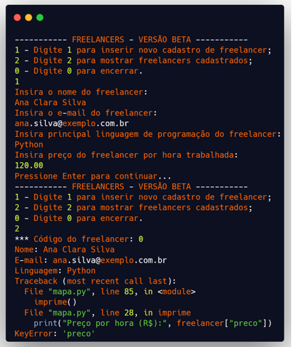
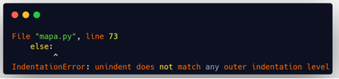
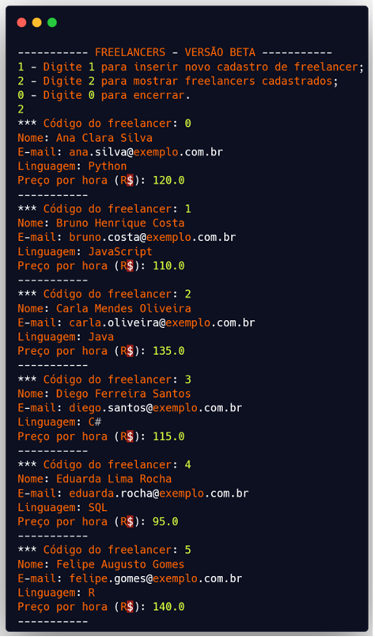
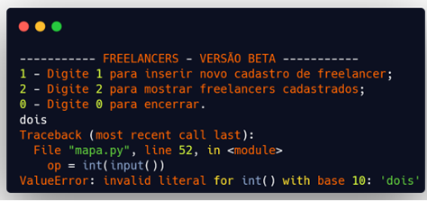
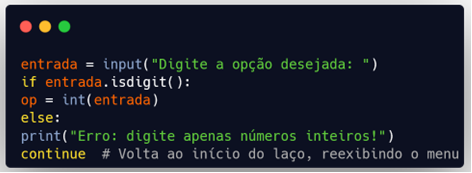
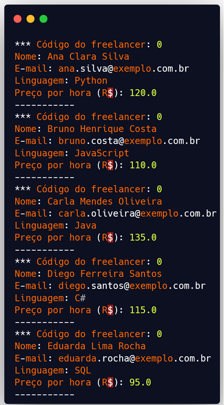

# Aplicação de Cadastro de Freelancers (Versão Beta)

Projeto desenvolvido para a atividade **MAPA** da disciplina **Linguagem de Programação** do curso de **Ciência de Dados e Análise do Comportamento (UniCesumar)**.

## Navegação Rápida
* [1. Contextualização e Objetivo](#1-contextualização-e-objetivo)
* [2. Código-Fonte Completo e Documentado](#2-código-fonte-completo-e-documentado)
* [3. Teste de Mesa (Massa de Dados de Validação)](#3-teste-de-mesa-massa-de-dados-de-validação)
* [4. Resolução das Questões e Evidências de Execução](#4-resolução-das-questões-e-evidências-de-execução)
  * [Questão A — Acesso a chave inexistente (Figura 1)](#questão-a)
  * [Questão B — Remoção da condição de limite (Figuras 2 e 3)](#questão-b)
  * [Questão C — Entrada não numérica e robustez (Figuras 4, 5, 6 e 7)](#questão-c)
  * [Questão D — Função da linha cont += 1 (Figura 8)](#questão-d)
* [5. Referências e Ferramentas](#5-referências-e-ferramentas)

---

## 1. Contextualização e Objetivo

O projeto consiste em uma aplicação de linha de comando (CLI) desenvolvida em Python para o cadastro e a listagem de até **5 freelancers**. Cada registro armazena um código identificador único (`cod`), nome, e-mail, linguagem de programação principal e valor por hora trabalhada.

---

## 2. Código-Fonte Completo e Documentado

O código completo e comentado pode ser acessado diretamente no arquivo [`mapa.py`](./mapa.py) ou visualizado abaixo:

~~~python
# ==============================================================================
# ATIVIDADE: MAPA - LINGUAGEM DE PROGRAMAÇÃO - 54_2026
# PROJETO: Aplicação de Cadastro de Freelancers (Versão Beta)
# OBJETIVO: Permitir o cadastro (até 5 registros) e a listagem de profissionais
#           utilizando listas, dicionários, funções e estruturas de repetição.
# CURSO: Ciência de Dados e Análise do Comportamento
# UNIVERSIDADE: UniCesumar
# ALUNO: Ricardo Freitas
# ==============================================================================

# 1. ESTRUTURA DE ARMAZENAMENTO GLOBAL
# Cria uma lista vazia que funcionará como o "banco de dados" em memória.
# Cada posição desta lista armazenará um dicionário representando um freelancer.
lista = []

# 2. DEFINIÇÃO DAS FUNÇÕES AUXILIARES

# A função imprime percorre todos os dicionários armazenados na 'lista' e exibe
# os dados formatados de cada freelancer cadastrado.
# O laço 'for' acessa um dicionário por vez dentro da lista.
def imprime():
    for freelancer in lista:
        print("*** Código do freelancer:", freelancer["cod"])
        print("Nome:", freelancer["nome"])
        print("E-mail:", freelancer["email"])
        print("Linguagem:", freelancer["linguagem"])
        print("Preço por hora (R$):", freelancer["valor"])
        print("-----------")

# A função menu exibe o cabeçalho e as opções de navegação disponíveis para o
# usuário. Não recebe parâmetros e não retorna valores; apenas imprime na tela.
def menu():
    print("----------- FREELANCERS - VERSÃO BETA -----------")
    print("1 - Digite 1 para inserir novo cadastro de freelancer;")
    print("2 - Digite 2 para mostrar freelancers cadastrados;")
    print("0 - Digite 0 para encerrar.")

# 3. VARIÁVEIS DE CONTROLE DO FLUXO

# 'cont' gera um identificador único (ID) sequencial iniciando em 0 (0, 1, 2, 3, 4).
cont = 0

# 'op' armazena a escolha do usuário no menu. Inicia com -1 (valor diferente de 0)
# para garantir que o programa entre no laço 'while' pela primeira vez.
op = -1

# 4. LOOP PRINCIPAL DA APLICAÇÃO
# Mantém o programa em execução contínua até que o usuário digite 0 para sair.
while op != 0:
    menu()             # Chama a função que desenha o menu na tela
    op = int(input())  # Lê a opção digitada e converte de texto (str) para inteiro

    # --- OPÇÃO 1: CADASTRAR NOVO FREELANCER ---
    if op == 1:
        if len(lista) < 5:   # Verifica se a lista ainda tem menos de 5 cadastros
            freelancer = {}  # Cria um dicionário vazio p/ agrupar os dados do novo cadastro

            # Preenche as chaves do dicionário com o ID automático e as entradas do usuário
            freelancer["cod"] = cont
            freelancer["nome"] = input("Insira o nome do freelancer:\n")
            freelancer["email"] = input("Insira o e-mail do freelancer:\n")
            freelancer["linguagem"] = input("Insira principal linguagem de programação do freelancer:\n")
            # Converte o texto p/ número decimal (float), exigindo ponto (ex: 120.00)
            freelancer["valor"] = float(input("Insira preço do freelancer por hora trabalhada:\n"))

            # Adiciona o dicionário preenchido ao final da lista principal
            lista.append(freelancer)
            # Incrementa o contador para que o próximo freelancer receba o próximo código
            cont += 1

        # Caso len(lista) já seja igual a 5, impede novos cadastros
        else:
            print("Lista de freelancers lotada!")
        # Pausa a execução para o usuário ler o resultado antes de reexibir o menu
        input("Pressione Enter para continuar...")

    # --- OPÇÃO 2: LISTAR FREELANCERS CADASTRADOS ---
    elif op == 2:
        # 'if not lista:' verifica se a lista está vazia (equivale a len(lista) == 0)
        if not lista:
            print("Lista de freelancers vazia!")
        else:
            # Se houver pelo menos 1 cadastro, chama a função de exibição
            imprime()
        input("Pressione Enter para continuar...")

    # --- VALIDAÇÃO DE OPÇÃO INVÁLIDA ---
    # Se 'op' não for 1, nem 2 e nem 0, informa que o comando não existe
    elif op != 0:
        print("Erro: opção inválida!")
        input("Pressione Enter para continuar...")
~~~

---

## 3. Teste de Mesa (Massa de Dados de Validação)

Para validar o comportamento do sistema e simular os cenários das questões abaixo, foram utilizados os seguintes registros de teste:

| Código (`cod`) | Nome | E-mail | Linguagem Principal | Preço por Hora (R$) |
| :---: | :--- | :--- | :--- | :---: |
| `0` | Ana Clara Silva | `ana.silva@exemplo.com.br` | Python | `120.00` |
| `1` | Bruno Henrique Costa | `bruno.costa@exemplo.com.br` | JavaScript | `110.00` |
| `2` | Carla Mendes Oliveira | `carla.oliveira@exemplo.com.br` | Java | `135.00` |
| `3` | Diego Ferreira Santos | `diego.santos@exemplo.com.br` | C# | `115.00` |
| `4` | Eduarda Lima Rocha | `eduarda.rocha@exemplo.com.br` | SQL | `95.00` |

---

## 4. Resolução das Questões e Evidências de Execução

### Questão A
> **Enunciado:** O código acima apresenta uma função chamada `imprime()`. Explique qual seria o comportamento do programa se, ao invés de `print("Preço por hora (R$):", freelancer["valor"])`, fosse utilizado `print("Preço por hora (R$):", freelancer["preco"])`.

**Resposta:**
Ao alterar a chave para `freelancer["preco"]`, o programa consegue cadastrar os freelancers normalmente (opção 1), mas falha ao tentar exibi-los (opção 2). Quando a função `imprime()` é chamada, ela exibe apenas os quatro primeiros campos do primeiro registro (`cod`, `nome`, `email` e `linguagem`) e, ao tentar acessar a chave `"preco"` — que não existe no dicionário, pois o dado foi armazenado sob a chave `"valor"` —, o Python interrompe a execução imediatamente gerando uma exceção do tipo `KeyError: 'preco'`, encerrando o programa de forma abrupta ([Figura 1](./imagens/figura1_keyerror.png)).

*Figura 1. Resultado do tipo de erro `KeyError: 'preco'`, encerrando o programa de forma abrupta ([abrir imagem em tela cheia](./imagens/figura1_keyerror.png)).*

---

### Questão B
> **Enunciado:** Analise o bloco de código que insere um novo cadastro na lista de freelancers. O que aconteceria se a linha `if len(lista) < 5:` fosse removida? Explique a consequência no funcionamento do programa.

**Resposta:**
* **Do ponto de vista sintático (remoção literal da linha):** Caso apenas a linha `if len(lista) < 5:` seja apagada sem ajustar o recuo (indentação) do bloco interno e sem remover o `else:` correspondente, o Python impedirá a execução do programa logo na leitura do arquivo, acusando um erro de sintaxe (`IndentationError: unindent does not match any outer indentation level`), pois o bloco fica recuado sem uma instrução condicional acima dele e o `else:` fica sem um `if` correspondente ([Figura 2](./imagens/figura2_indentation_error.png)).

*Figura 2. Resultado ao apagar a linha `if len(lista) < 5:` sem ajustar o recuo (indentação) do bloco interno e sem remover o `else:` correspondente ([abrir imagem em tela cheia](./imagens/figura2_indentation_error.png)).*

* **Do ponto de vista funcional (ajustando a estrutura do bloco):** Se a estrutura condicional de verificação de tamanho for removida corretamente (ajustando a indentação e removendo o `else:`), o programa executará normalmente, mas perderá a regra de negócio que limita o sistema a no máximo 5 cadastros. Com isso, o usuário poderá inserir freelancers indefinidamente na lista (6, 7 ou mais registros), e a mensagem `"Lista de freelancers lotada!"` nunca será exibida ([Figura 3](./imagens/figura3_lista_ilimitada.png)).

*Figura 3. Resultado ao apagar a linha `if len(lista) < 5:` ajustando o recuo (indentação) do bloco interno e removendo o `else:`. Observa-se que o programa permite cadastrar mais de 5 freelancers sem exibir a mensagem de lista lotada ([abrir imagem em tela cheia](./imagens/figura3_lista_ilimitada.png)).*

---

### Questão C
> **Enunciado:** A função `menu()` é responsável por exibir as opções para o usuário. Suponha que, na linha `op = int(input())`, o usuário digite um valor não numérico. Qual será o comportamento do programa e o que poderia ser feito para melhorar a robustez dessa linha?

**Resposta:**
A instrução `op = int(input())` lê a opção digitada pelo usuário e converte de texto (`str`) para inteiro (`int`). É justamente essa conversão que falha quando o usuário digita um valor não numérico (como `"dois"`), pois a função `int()` não consegue converter esse texto para um número inteiro na base 10. Como não há tratamento de erro no código original, o Python lança a exceção `ValueError: invalid literal for int() with base 10: 'dois'` e interrompe a execução do programa imediatamente de forma abrupta ([Figura 4](./imagens/figura4_value_error.png)).

*Figura 4. Resultado quando o usuário digita um valor não numérico (como `"dois"`) ([abrir imagem em tela cheia](./imagens/figura4_value_error.png)).*

Para melhorar a robustez do código contra entradas inválidas em Python, existem duas formas principais de impedir que o programa trave:

#### 1. Tratamento de exceções com `try / except ValueError`
Envolve a leitura e a conversão em um bloco `try / except` (dentro de um laço `while True`) para capturar o `ValueError`, exibir uma mensagem amigável orientando o usuário a digitar apenas números e solicitar a entrada novamente sem encerrar o sistema ([Figura 5](./imagens/figura5_codigo_try_except.png) e [Figura 6](./imagens/figura6_saida_try_except.png)).

*Figura 5. Abordagem 1: Usando `try / except` (padrão recomendado em Python) ([abrir imagem em tela cheia](./imagens/figura5_codigo_try_except.png)).*

*Figura 6. Resultado após a implementação do `try / except ValueError` ([abrir imagem em tela cheia](./imagens/figura6_saida_try_except.png)).*

#### 2. Validação condicional prévia (`.isdigit()`)
Lê a entrada primeiro como texto (`entrada = input()`) e verifica com `if entrada.isdigit():` se todos os caracteres são dígitos numéricos antes de executar a conversão `int(entrada)` ([Figura 7](./imagens/figura7_codigo_isdigit.png)).

*Figura 7. Abordagem 2: Usando validação condicional com `.isdigit()` ([abrir imagem em tela cheia](./imagens/figura7_codigo_isdigit.png)).*

---

### Questão D
> **Enunciado:** Observe a linha `cont += 1`. Explique a função dessa linha no contexto do código e descreva o que aconteceria se ela fosse removida.

**Resposta:**
* **Definição e explicação da função da linha `cont += 1`:** A linha `cont += 1` (equivalente a `cont = cont + 1`) tem a função de incrementar o contador sequencial utilizado para gerar um código identificador único (`cod`) para cada freelancer cadastrado (gerando os códigos `0`, `1`, `2`, `3` e `4` a cada nova inserção).
* **Consequência caso a linha `cont += 1` fosse removida:** O programa continuaria funcionando e o limite máximo de 5 cadastros não seria afetado, pois esse controle é feito pelo tamanho da lista (`if len(lista) < 5:`), e não pela variável `cont`. No entanto, como `cont` foi inicializado com `0` e nunca seria atualizado, todos os freelancers cadastrados receberiam o mesmo código (`Código do freelancer: 0`), violando a regra de identificação única de cada registro ([Figura 8](./imagens/figura8_codigos_repetidos.png)).

*Figura 8. Resultado com a remoção da linha `cont += 1`. Todos os freelancers cadastrados receberam o mesmo código (`Código do freelancer: 0`), violando a regra de identificação única de cada registro ([abrir imagem em tela cheia](./imagens/figura8_codigos_repetidos.png)).*

---

## 5. Referências e Ferramentas

* OLIVEIRA, P. M. de. **Linguagem de programação**. Maringá: UniCesumar, 2023.
* Para a geração visual dos trechos de código e saídas de terminal, utilizou-se a ferramenta [Carbon](https://carbon.now.sh/).
* Pasta completa de evidências visuais: [`/imagens`](./imagens).

---
**Autor:** Ricardo Freitas  
**GitHub:** [@Freitas-Dias](https://github.com/Freitas-Dias)
